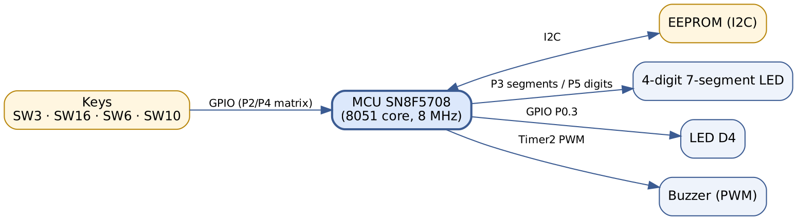
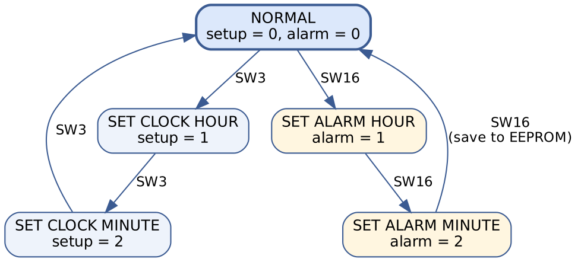
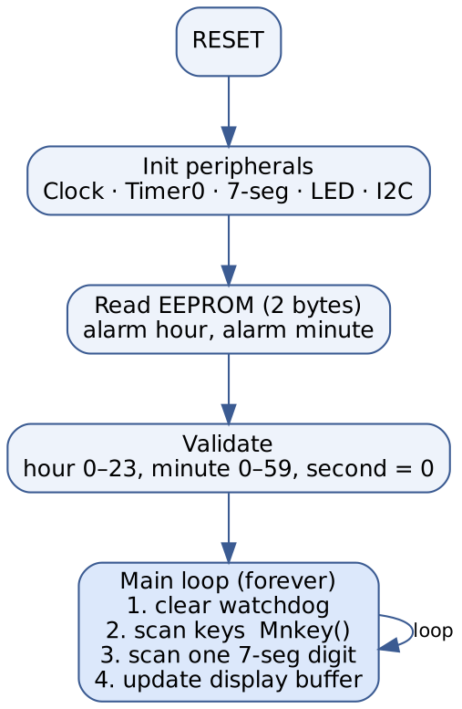
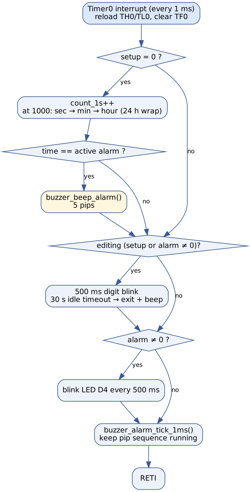
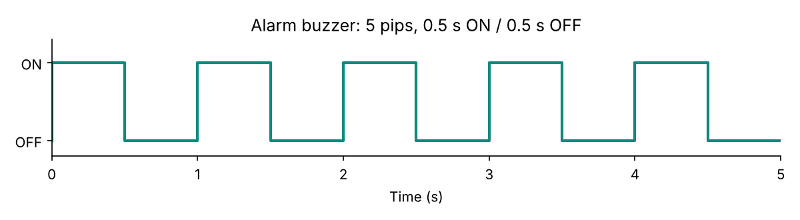
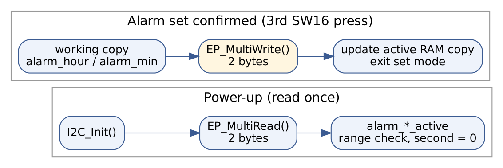

# Digital Clock with Alarm on SN8F5708 (MCU part – TripleCamp)

A 4-digit digital clock with an alarm, built on the **SONiX SN8F5708 EVK** (8051 core) in C with **Keil C51**. This repository contains the **MCU part** of the *TripleCamp* entry for the **Central Region Expanded FPGA and MCU Design Competition 2026** (preliminary round). The FPGA part (Gowin GW1N, UART/PWM/FSM) is a separate sub-project.

Team TripleCamp: Lê Khắc Nghĩa · Phạm Đông Trà · Huỳnh Thị Hồng Tú

## Features

- Time shown as `HH.MM` (24 h) on a 4-digit 7-segment display; clock starts at `00.00`.
- Set the current time and the alarm time with four keys; values wrap around (23 → 0, 59 → 0 and back).
- The digit pair being edited blinks (500 ms); the alarm-set mode also blinks LED D4.
- 0.3 s key beep on every valid key press; the alarm plays **5 pips** (0.5 s ON / 0.5 s OFF, ≈ 5 s).
- Alarm hour and minute are **stored in I2C EEPROM** and restored after power loss (alarm second is always 0).
- **30 s idle timeout** leaves any set mode without saving.
- Watchdog is cleared every main-loop pass; key scanning uses software debounce and acts only on the press edge (holding a key does not repeat).

## Hardware

| Item | Details |
|---|---|
| Board | SN8F5708_EVK (SONiX SN8F5708, 8051 core) |
| Clock | 32 MHz source, CPU divided by 4 → Fcpu = 8 MHz |
| Display | 4-digit 7-segment: segments on `P3`, digit select on `P5.0–P5.3` |
| Keys | Key matrix: rows `P4.4` / `P4.7`, columns `P2.4–P2.7` |
| LED D4 | `P0.3` |
| Buzzer | PWM from Timer2 compare channel |
| Memory | I2C EEPROM, device address `0xA0`, alarm hour at `0x00`, alarm minute at `0x01` |



## Controls

| Key | Function |
|---|---|
| **SW3** | Cycle: normal → set hour → set minute → normal (current time) |
| **SW16** | Cycle: normal → set alarm hour → set alarm minute → normal (3rd press **saves** the alarm to EEPROM) |
| **SW6** | Increase the value being edited |
| **SW10** | Decrease the value being edited |

The two edit modes are mutually exclusive. The clock does not count while the current time is being set.



## Software architecture

A **super-loop plus periodic interrupt** design. Everything time-critical runs in the Timer0 ISR; slow work (key scan, display refresh, EEPROM access) stays in the main loop so the ISR remains short.

| Domain | Task |
|---|---|
| Start-up | Configure clock, Timer0, 7-segment, LED D4, I2C; read EEPROM once |
| Main loop | Clear watchdog, scan keys, scan one display digit, update display buffer |
| Timer0 ISR (1 ms) | Time keeping, 500 ms blink phase, 30 s timeout, LED D4, alarm-pip sequencer |
| Timer2 ISR | Maintain buzzer tone and beep duration, switch PWM off at the end |



### Timing

Timer0 runs from fosc/32 = 1 MHz and is reloaded with `65536 − 1000 = 0xFC18`, giving a 1 ms interrupt; 1000 interrupts make one second.



### Alarm buzzer

When hour, minute and second all equal the active alarm, `buzzer_beep_alarm()` arms a sequence of 5 pips. `buzzer_alarm_tick_1ms()` (called from the Timer0 ISR) starts one 500 ms pip every 1000 ms without any blocking delay.



### EEPROM handling

Only two bytes (hour, minute) are stored. They are read once at start-up and range-checked (invalid values fall back to 0); they are written only when the alarm is confirmed, never on every increment. A timeout leaves the saved alarm untouched.



## Repository layout

```
keil/
  5708_demo.uvproj       Keil µVision project (device SN8F5708)
  STARTUP.A51, OPTIONS_SN8F5708.A51
  Source/
    main.c               Init, EEPROM load, super-loop
    timer0.c/.h          1 ms tick, clock, blink, timeout, LED D4
    7segment_led.c/.h    Digit scan and HH.MM display buffer
    key.c/.h             Matrix scan, debounce, mode/edit logic, EEPROM save
    pwm.c/.h             Timer2 buzzer, key beep, alarm pip sequencer
    led.c/.h             LED D4 driver
    i2c.c/.h             I2C driver and EP_MultiRead / EP_MultiWrite
    spi.c/.h             SPI driver (not used; its include is commented out in main.c)
    mcu.h                Device header include
firmware/
  key_demo.hex           Pre-built image from the submission
docs/
  images/                Diagrams used in this README
  report/                Original technical report (Vietnamese, .docx)
```

## Build and flash

1. Open `keil/5708_demo.uvproj` in Keil µVision with the SONiX SN8F5708 device pack installed.
2. Build (F7). The project output name is `key_demo`.
3. Program `key_demo.hex` to the EVK with the SONiX programmer/ISP tool.

`firmware/key_demo.hex` is the image found in the submitted project; rebuild from source if you change anything.

## Verification status

Behaviour listed above was checked against the source code (see the report, section 5). The report also defines a 9-case on-board test matrix (power-up, 65 s run, set time, set and save alarm, power-cycle, alarm trigger, idle timeout, LED D4, key hold); record your measured results there once run on the board.

## Known issues / ideas

- Variables shared between the ISR and the main loop (`sec`, `min`, `hour`, `setup`, `alarm`, `alarm_*_active`, …) are not declared `volatile`.
- The display reads `hour/min/sec` while the ISR may update them, so a one-frame glitch is possible at a minute/hour rollover.
- `EP_MultiWrite()` blocks the main loop (and therefore display scanning) while the EEPROM is written.
- EEPROM device address and cell addresses are hard-coded in `key.h`; confirm them and the write-cycle time on your board.
- While setting the current time the clock is paused and seconds are not reset.
- LED D4 polarity must be checked on the board (the code drives `P0.3`).
